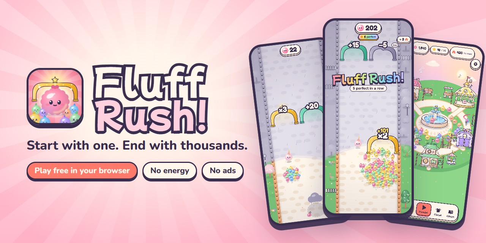

  

<h3 align="center"><a href="https://urbantorque.github.io/fluff-rush-play/">Play Fluff Rush in your browser →</a></h3>

Free · no install · no sign-up · phone and desktop

Steer a parade of Flufflings, wake sleeping giants and bring a village back to life. Between roads, grow connected garden patches, cook for celebrations and follow lantern trails through the mist.

## How to play

- **Parade:** drag sideways, or use A/D or the arrow keys. Tap or press Space to use your leader's call. Choose number gates, gather sleeping friends and steer around hazards.
- **Fields:** choose seeds, plant and water them, then harvest connected patches. Your harvest stocks the village pantry for recipes and festivals.
- **Wilds:** follow the lantern trails, solve spatial puzzles and bring keepsakes home. Free practice is available on completed trails.

Your progress saves in your browser. Use a private browsing window to try a fresh game without changing your usual save.

## What's in this build

- 30 main Parade roads across four valleys, plus bonus roads.
- 15 story trails and their mastery variants.
- One village, shared garden and pantry, seven story festivals, and a complete ending.
- Endgame Parade trials, garden puzzles and Wilds masteries with saved personal records.
- Optional festival years, garden visits, Encores and the Daily Parade.

The web playtest has no ads or purchases. There is no account to create.

## Share or send feedback

Send friends the **[play link](https://urbantorque.github.io/fluff-rush-play/)**. It opens the game directly on a phone or computer.

Found a problem? **[Open an issue](https://github.com/urbantorque/fluff-rush-play/issues)** with your device/browser, what you were doing and what happened. Screenshots help. Tell us which moments you wanted to replay and where the game felt slow or confusing.

On iPhone, Share → Add to Home Screen opens it like an app.

---

© 2026 urbantorque. All rights reserved. This repository hosts the playable build (40e9822-10fc7b782c); the game's source is private. Fonts: Mochiy Pop One, Fredoka and Nunito (SIL Open Font License). Icons: Phosphor (MIT).
