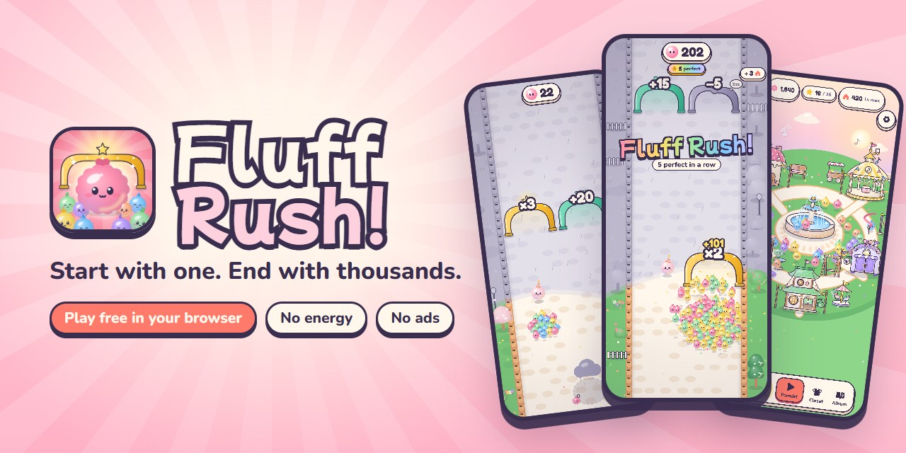

  

<h3 align="center"><a href="https://urbantorque.github.io/fluff-rush-play/">Play Fluff Rush in your browser →</a></h3>

Free · no install · no sign-up · phone and desktop

Steer a parade of Flufflings, wake sleeping giants and bring everyone Home. Choose a leader, find your way through four valleys, and take your friends on a travelling outing.

## How to play

- **Parade:** drag sideways, or use A/D or the arrow keys. Tap or press Space to use your leader's call. Choose number gates, gather sleeping friends and steer around hazards.
- **Troupe:** choose a friend to lead, learn their call in a free lesson, or dress your parade.
- **Home:** meet the company you brought back, share a moment with a friend and display an earned keepsake.

Your progress saves in your browser. Use a private browsing window to try a fresh game without changing your usual save.

[Watch the phone playtest](https://urbantorque.github.io/fluff-rush-play/phone-replay/), including the first Town visit, Seedfall and Tambo’s Drum Call at normal speed.

## Director’s pass

At the second Festival hedge, send 600 friends through the left wall and Gobbo will fly their pennant on his hill. At the fountain, return after breakfast to see what the Giant makes with Suki’s wrapper.

[Watch the before-and-after reel](https://urbantorque.github.io/fluff-rush-play/directors-pass/) · [Play the two-hour save](https://urbantorque.github.io/fluff-rush-play/directors-pass/checkpoint.html?scene=two-hours) · [Read the release judgement](https://urbantorque.github.io/fluff-rush-play/directors-pass/release.html) · [Read the pacing ledger](https://urbantorque.github.io/fluff-rush-play/directors-pass/pacing.html) · [Download the tested ZIP](https://urbantorque.github.io/fluff-rush-play/directors-pass/Fluff-Rush-c8b5302f32d2.zip)

## What's in this build

- 30 main Parade roads across four valleys, plus bonus roads.
- Four illustrated valleys, living giants and familiar friends beside your next departure.
- A woodland rehearsal clearing for Troupe, expressive companions and immediate leader selection.
- An illustrated Home, gentle environmental motion, reduced-motion support and refined phone controls.
- Five leaders with different calls and shared friendship activities.
- Four three-chapter outings with saved route choices and travelling company.
- Free practice for recorded road encounters, six mastery challenges and the Daily Parade.
- Optional, untimed destination activities and a Home that remembers your journeys.

The web playtest has no ads or purchases. There is no account to create.

## Share or send feedback

Send friends the **[play link](https://urbantorque.github.io/fluff-rush-play/)**. It opens the game directly on a phone or computer.

Found a problem? **[Open an issue](https://github.com/urbantorque/fluff-rush-play/issues)** with your device/browser, what you were doing and what happened. Screenshots help. Tell us which moments you wanted to replay and where the game felt slow or confusing.

On iPhone, Share → Add to Home Screen opens it like an app.

---

© 2026 urbantorque. All rights reserved. This repository hosts the playable build (c8b5302f32d2); the game's source is private. Fonts: Alegreya, Mochiy Pop One, Fredoka and Nunito (SIL Open Font License). Icons: Phosphor (MIT).
