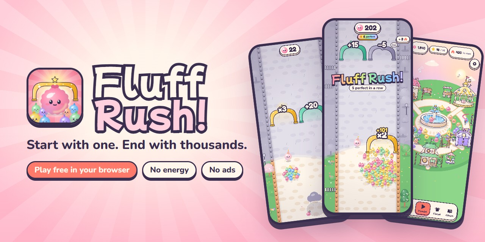

  

<h3 align="center"><a href="https://urbantorque.github.io/fluff-rush-play/">Play Fluff Rush in your browser →</a></h3>

Free · no install · no sign-up · phone and desktop

Steer a parade of Flufflings, wake sleeping giants and bring everyone Home. Choose a leader, find your way through four valleys, and take your friends on a travelling outing.

## How to play

- **Parade:** drag sideways, or use A/D or the arrow keys. Tap or press Space to use your leader's call. Choose number gates, gather sleeping friends and steer around hazards.
- **Troupe:** choose a friend to lead, learn their call in a free lesson, or dress your parade.
- **Home:** meet the company you brought back, share a moment with a friend and display an earned keepsake.

Your progress saves in your browser. Use a private browsing window to try a fresh game without changing your usual save.

## What's in this build

- 30 main Parade roads across four valleys, plus bonus roads.
- Illustrated road maps, living giants and a travelling company beside your next departure.
- A new illustrated Home, softer character art across Roads and Troupe, gentle environmental motion and refined phone controls.
- Five leaders with different calls and shared friendship activities.
- Four three-chapter outings with saved route choices and travelling company.
- Free practice for recorded road encounters, six mastery challenges and the Daily Parade.
- Optional, untimed destination activities and a Home that remembers your journeys.

The web playtest has no ads or purchases. There is no account to create.

## Share or send feedback

Send friends the **[play link](https://urbantorque.github.io/fluff-rush-play/)**. It opens the game directly on a phone or computer.

Found a problem? **[Open an issue](https://github.com/urbantorque/fluff-rush-play/issues)** with your device/browser, what you were doing and what happened. Screenshots help. Tell us which moments you wanted to replay and where the game felt slow or confusing.

On iPhone, Share → Add to Home Screen opens it like an app.

---

© 2026 urbantorque. All rights reserved. This repository hosts the playable build (6dac364); the game's source is private. Fonts: Alegreya, Mochiy Pop One, Fredoka and Nunito (SIL Open Font License). Icons: Phosphor (MIT).
